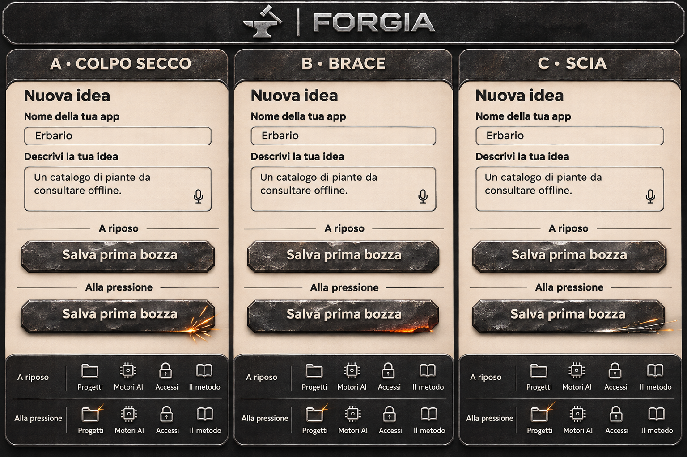

# Identità visiva di Forgia

## Decisione approvata — B · Brace

I tasti riprendono il ferro scuro di un’incudine, con patina irregolare, segni di martellatura, bordi smussati e riflessi argentati. Alla pressione un bagliore arancio breve e localizzato affiora sotto un tratto del bordo, con una piccola scintilla che si spegne subito. La superficie del tasto resta metallica. Le icone in acciaio riprendono lo stesso effetto in scala ridotta. Un bordo d’acciaio più luminoso segnala la voce selezionata.

La B approvata è la variante **Brace** dei controlli. La tavola **B · Acciaio** è una proposta tipografica precedente conservata come riferimento.

## Palette e schermate

Ferro scuro per testata e navigazione, acciaio satinato per marchio e bordi, toni caldi del legno per le superfici di lavoro, arancio brace per la luce del tocco. La foto del fabbro al lavoro mostra il braccio e il martello sul ferro caldo, l’incudine sul ceppo e la fucina, con il volto fuori campo.

- [Fabbro al lavoro](fabbro-al-lavoro.png) e [fucina originale](fucina.png)
- [Ingresso, nuova idea e progetto](anteprima-interfaccia.png)
- [Progetto, Motori AI, Accessi e Il metodo](schermate-cromo.png)

Le tavole sono mockup. I pulsanti arancioni delle anteprime precedenti sono superati dalla scelta Brace.

## Marchio e lettering

Marchio di riferimento FORGIA largo e smussato, ispirato alla tavola Cromo. Incudine e martello costituiscono il simbolo per le icone iOS e Android. Work Sans è il candidato per il testo di interfaccia. Il lettering dedicato è in fase di studio e il font installabile resta da sviluppare.

- [A · Cromo](identita-a-cromo.png)
- [B · Acciaio](identita-b-acciaio.png)
- [C · Titanio](identita-c-titanio.png)
